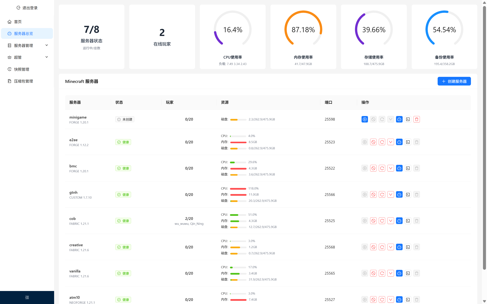
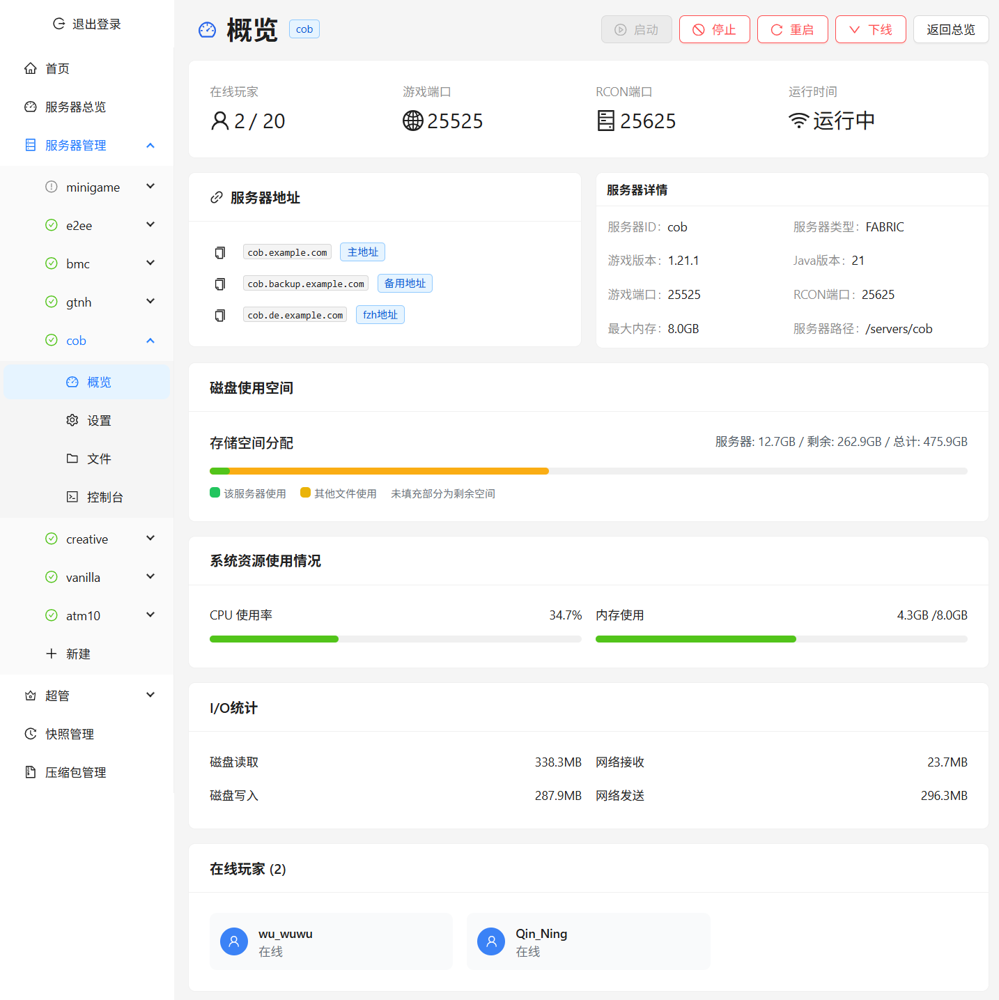
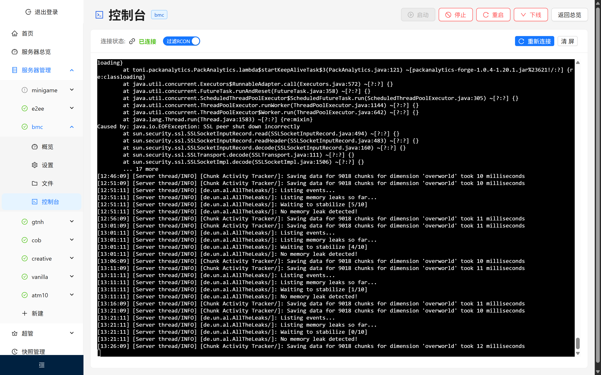
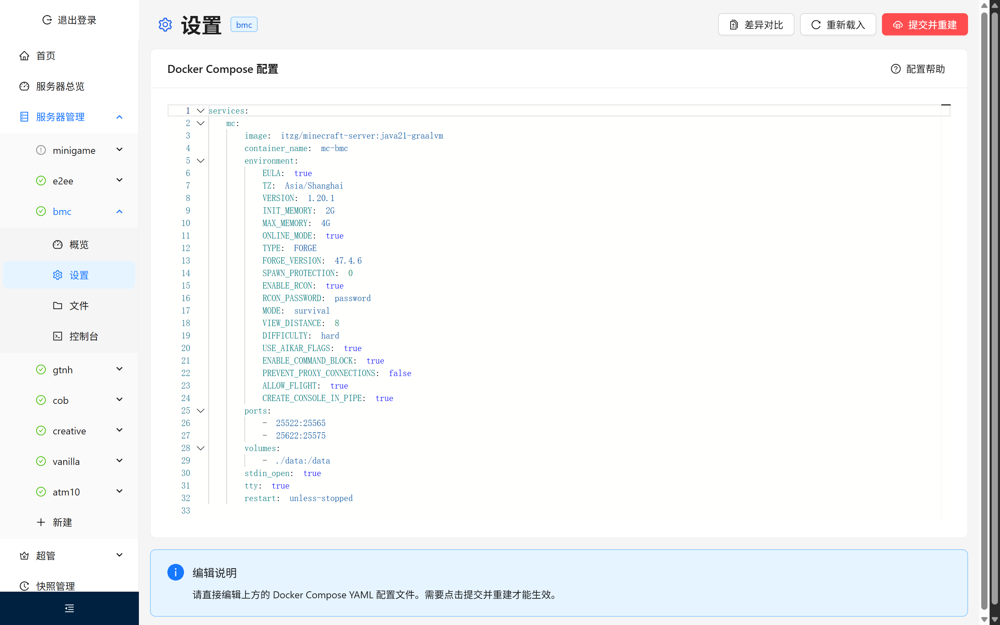
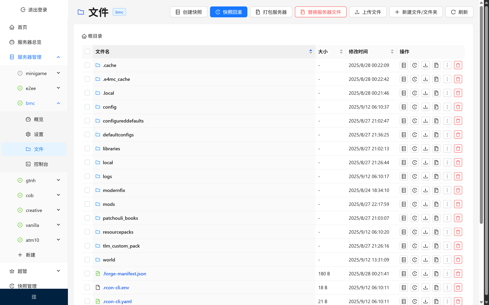
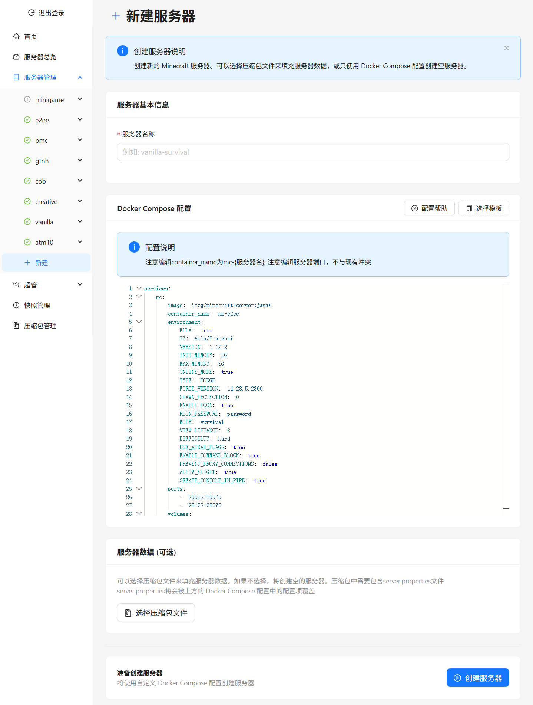
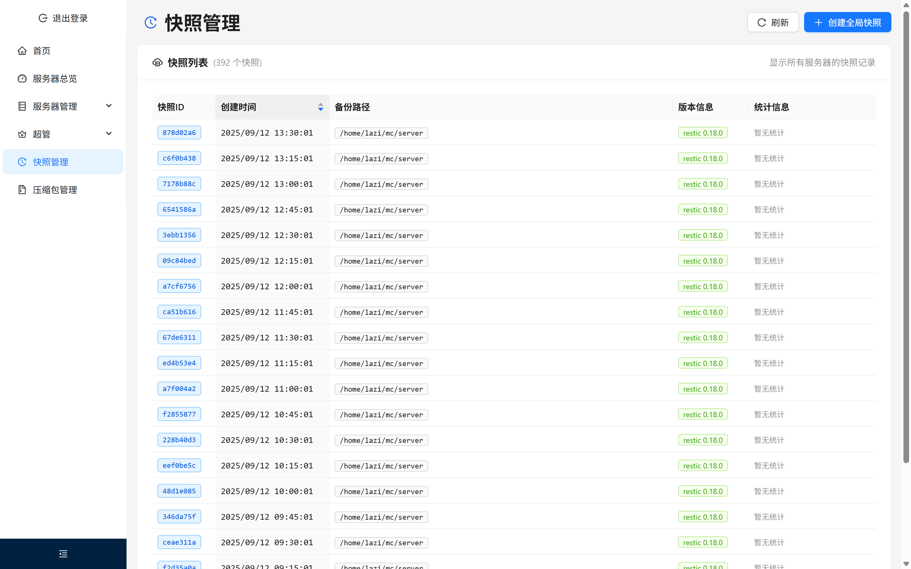
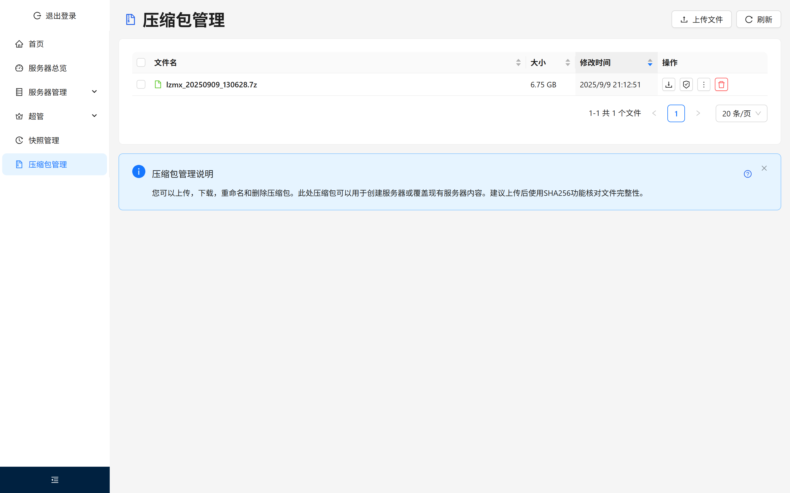

# MC-Admin

Minecraft 服务器管理平台，提供多服务器管理、实时监控、快照备份和智能DNS路由等功能。

## 功能特性

- 🖥️ 现代化 Web 界面，支持实时监控和操作
- 🐳 Docker 容器化部署，支持 Docker Compose 配置管理
- 📊 实时资源监控（CPU、内存、磁盘、网络）
- 💾 快照备份系统（基于 Restic）
- 🎮 实时控制台和命令执行
- 👥 用户权限管理和角色控制
- 🌐 智能 DNS 路由管理（支持多云厂商）

## 开发与文档

启动后端和前端见[开发环境](docs/development.md)，架构与功能说明从[文档索引](docs/README.md)进入。
开发约束见[AGENTS.md](AGENTS.md)，完整验证与发布分别见[CI](docs/ci.md)和[发布流程](docs/release.md)。
后续工作通过[项目看板](https://github.com/users/xyqyear/projects/7)管理。

## 界面预览

### 仪表盘

### 服务器概览

### 实时控制台

### Docker Compose 配置

### 文件管理

### 创建服务器

### 快照管理

### 压缩包管理

